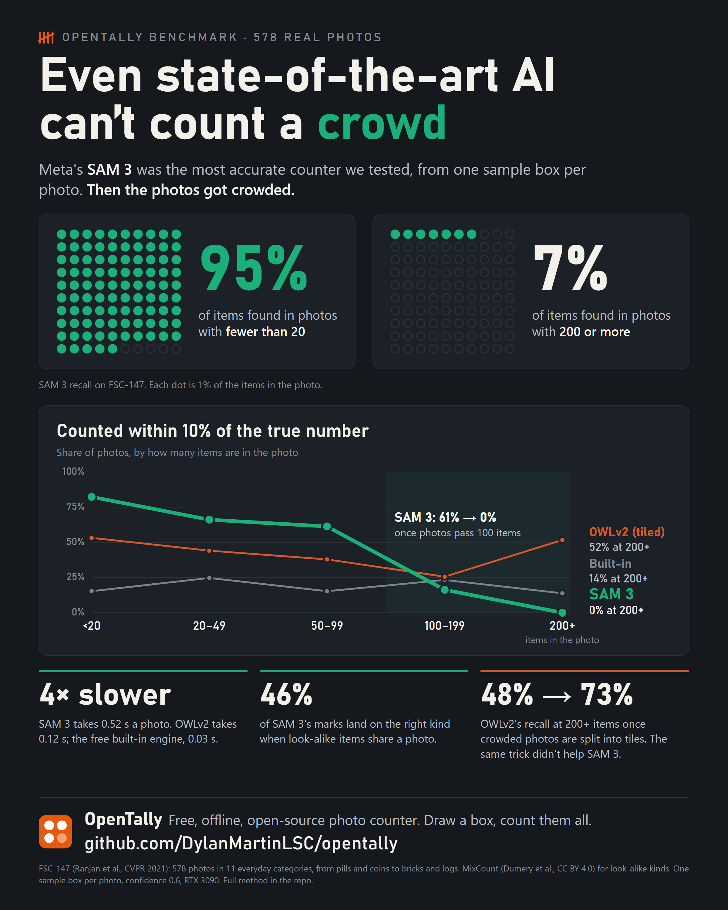

# OpenTally

**Count anything in a photo: free, offline, open source.**

Pipes, logs, rebar, pills, cans, cells, seeds. Draw a box around one item and
OpenTally counts every similar item. You can tap to fix any misses, then export
the tally.

- **No subscription, no account, no upload.** Photos never leave your device.
- **No templates to buy.** One sample box tells it what to count.
- **Works anywhere.** It runs in the browser, on a laptop, tablet or phone.
- **Optional local AI.** Run SAM 3 or OWLv2 on your own GPU for hard scenes
  (cluttered shelves, mixed items, low contrast), or type what to count
  ("pipe", "white oval").

<p align="center">
  
</p>

## Quick start

```bash
npm start
```

Then open http://127.0.0.1:8080. There are no dependencies, only Node 20+ to serve the files.

1. **Open a photo.** Use the button, drag-and-drop, paste (Ctrl+V), or "Take a photo" on a phone. Or try one of the examples on the start screen.
2. **Draw a box around one item.** Everything similar is counted.
3. **Fix up.** Tap to add a missed item; right-click (or use Remove) to delete a wrong one.
4. **Export.** Annotated PNG, summary CSV, per-mark CSV, or a project file you can reopen later.

Other tools: **Region** limits counting to part of the photo. **Categories** let
you count several kinds of item in one photo. **Presets** tune the built-in
engine for pipes, logs, rebar, pills, cells and boards.

| Key | Action |
|-----|--------|
| `S` / `A` / `R` / `G` | Sample box / Add / Remove / Region |
| `Space` + drag, middle-drag | Pan |
| Wheel, pinch, `+` / `-` | Zoom |
| `0` | Fit to screen |
| `Enter` | Count again |
| `Ctrl+Z` / `Ctrl+Y` | Undo / redo |

## Choosing an engine

Measured on 578 real photos (FSC-147) and 1,462 mixed-kind scenes (MixCount),
one sample box per photo, on an RTX 3090. Full method and per-category results
in [eval/README.md](eval/README.md).

| Engine | Needs | Photos counted within 10% | Median error | Time per photo |
|---|---|---|---|---|
| Built-in | nothing (runs in the browser) | 19% | 34% | 28–207 ms |
| OWLv2 | local AI server, GPU recommended | 43% | 14% | ~130 ms |
| SAM 3 | local AI server, GPU, gated weights | 55% | 8% | ~520 ms |

- **SAM 3** is the most accurate up to about 100 items per photo.
- **OWLv2** is better for very crowded photos (200+ items), where it splits the photo into tiles.
- **Every engine also counts look-alike kinds** when several share a photo. Raise **Confidence** to separate them, at the cost of missing some items.

## How the built-in engine works

It uses classic computer vision with no ML, running in a Web Worker:

1. The photo is downscaled to at most 1200 px, converted to grayscale and lightly blurred.
2. A threshold is computed with Otsu's method. With a sample box, it is computed
   around the sample, and the box centre shows whether items are darker or
   lighter than the background. Colour mode matches the sample's colour instead.
3. The mask is cleaned, and connected blobs are found.
4. Touching items are split with a Euclidean distance transform. Each peak is
   one item, unless the path to a neighbouring peak never dips. That means a
   ridge in one long item (a board end), not a neck between two round ones.
5. The sample box sets the expected size, so crumbs and specks are ignored.

It is best for roughly round or blocky items that contrast with the
background.

## Optional: local AI engine

A small server on your own machine runs
[SAM 3](https://huggingface.co/facebook/sam3) or
[OWLv2](https://huggingface.co/google/owlv2-base-patch16-ensemble). Both find
every instance of what's in your sample box, or of a short phrase.

```bash
# install torch and torchvision for your GPU first: https://pytorch.org/get-started/locally/
pip install -r backend/requirements.txt
hf auth login                      # only for SAM 3: request access at huggingface.co/facebook/sam3 first
python backend/sam3_server.py      # listens on 127.0.0.1:8770 only
```

Then pick **Local AI** under Counting → Engine. The first start downloads the
model to your Hugging Face cache: about 3.4 GB for SAM 3, 620 MB for OWLv2.

- `OPENTALLY_MODEL=auto|sam3|owlv2` chooses the model. `auto` (the default) uses SAM 3 if it loads, otherwise OWLv2.
- `PORT` changes the port. Change the Backend address in the app to match.
- `python backend/try_sam3.py photo.jpg --box X0 Y0 X1 Y1` (or `--text pipe`) counts one photo from the command line and saves a marked-up copy.

## Example images and evaluation

The start screen offers a generated pipe stack and three rendered scenes from
[MixCount](https://huggingface.co/datasets/CorentinDumery/MixCount), each with
its known answers.

[eval/](eval/README.md) scores every engine on FSC-147 and MixCount from a
single sample box, and times them. The datasets are downloaded separately and
aren't in this repository.

## Development

```bash
npm test                                   # app, counting engine, session, export, AI client
pip install -r backend/requirements-test.txt
python -m unittest discover backend        # AI server, with a stand-in model
```

```
index.html, src/app.js, src/styles.css   UI
src/worker.js                            runs detection off the main thread
src/core/imageops.js                     grayscale, blur, Otsu, labelling, distance transform
src/core/detect.js                       the built-in counting pipeline
src/core/session.js                      categories, marks, undo/redo, save/load
src/core/export.js                       CSV export
src/core/sam-client.js                   client for the local AI server
backend/sam3_server.py                   local AI server (SAM 3 or OWLv2)
eval/                                    benchmark harness and results
SPEC.md                                  requirements, each mapped to its tests
```

## Licences

- OpenTally's code: MIT, see [LICENSE](LICENSE).
- Example scenes in `examples/`: CC BY 4.0, from MixCount, credited in [examples/ATTRIBUTION.md](examples/ATTRIBUTION.md).
- AI models aren't included. They download from Hugging Face under their own
  licences: OWLv2 is Apache-2.0, and SAM 3 uses Meta's SAM licence. Check it
  before commercial use.
